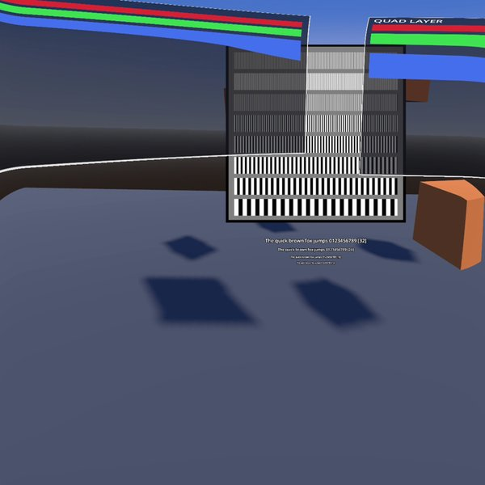
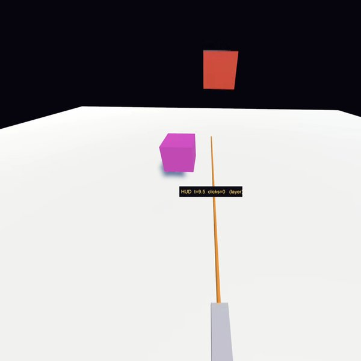
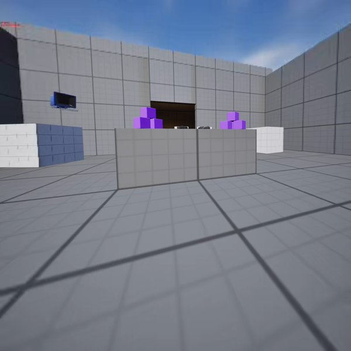
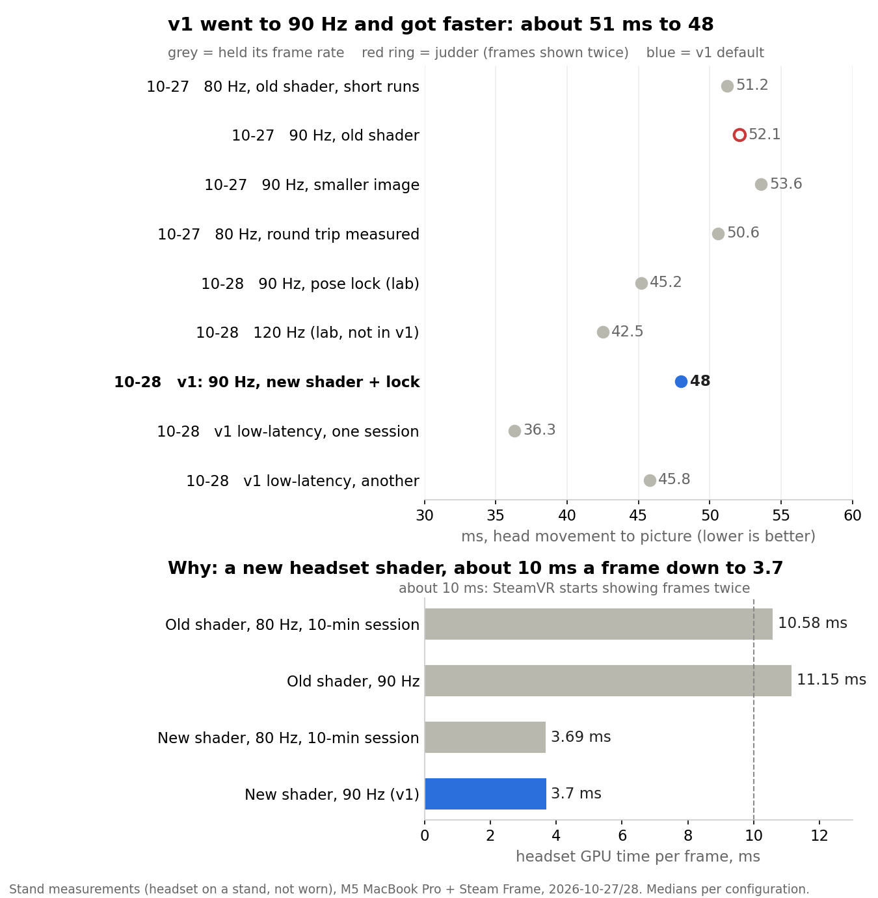

# frame-stream — Unity, Unreal, Godot and PC VR games from a Mac into the Steam Frame


Stream a VR scene from an Apple Silicon Mac to a Steam Frame headset over a USB-C cable or Wi-Fi, at 90 Hz
by default, with hardware decode on the headset and about 46 ms from head sample to photons. Also, there is the nuance that turning your
head does not wait for that latency: the headset re-aims each frame for rotation at display time.

| Godot 4 | Unity 6 | Unreal 5.8 |
|:---:|:---:|:---:|
|  |  |  |
| menu layers and a resolution chart | a HUD and the controller's aim ray | the engine's default level |

<sub>Captured on the headset itself, not on the Mac: the picture the client decoded (Godot) or the eye it
handed to SteamVR (Unity and Unreal), with the headset on a stand or a dummy head. One eye, cropped square.</sub>

**Quick start.** Turn on developer mode on the headset first (Settings → System → Enable Developer Mode, with a
password). Then, in Terminal on the Mac:

```sh
git clone <this repository's URL> ~/src/frame-stream && cd ~/src/frame-stream
./install.sh                                      # Xcode, Homebrew, the runtime, Godot, the headset; asks before each
bin/frame-stream up --app godot                   # or unity, unreal
bin/frame-stream down
```

`install.sh` checks each step first, explains it, and asks before it installs or changes anything; run it again
after anything stops it, and finished steps are skipped. `./install.sh --check` only reports what is missing.
"Install", below, is the same thing by hand.

**Contents:** [What it looks like](#what-it-looks-like) · [Measured](#measured) · [What we learned](#what-we-learned) ·
[Where to push next](#where-to-push-next) · [New to this?](#new-to-this-the-whole-setup-in-plain-steps) ·
[Requirements](#requirements) · [Install](#install) · [Run](#run) · [Uninstall](#uninstall) · [Layout](#layout) ·
[Rough edges](#rough-edges) · [Contributing](#contributing) · [Support](#support) · [Upstream](#upstream) ·
[Licence](#licence)

It's built on [OXRSys](https://github.com/demonixis/oxrsys), an open-source OpenXR runtime for macOS that renders
through Metal and streams HEVC. This repository adds the Steam Frame side and the glue:

- **a Steam Frame client** (patches on OXRSys pull request #30) that runs on the headset itself, decodes with the
  SoC's HEVC decoder, submits each eye to SteamVR, and sends head tracking back with a measured latency report;
- **runtime fixes** for the Mac side (a tracking bug that drops every packet after a clock change, a firewall-friendly
  video return path, pacing to the panel's rate, a lock that fetches each head pose a fixed 3 ms after it lands, foveated encoding sized for the Frame, and an optional low-latency VideoToolbox
  mode, off in the shipped config), and an opt-in positional reprojection that sends the app's depth to the headset
  as a small grid so SteamVR can correct for head movement, not only rotation;
- **engine projects** that prove the chain: Godot 4 (Vulkan via MoltenVK), Unity 6 (OpenXR package, Metal) and
  Unreal 5.8 (a small OpenXR HMD plugin, FrameXR, because Epic's OpenXR plugin has no Metal path), plus two larger
  scenes: Epic's VR Template lobby and a Unity URP stress scene, both at 90 fps;
- **PC VR games under free Wine** (`wine/`): Windows games you own on Steam, no PC and no SteamVR.
  Three games work: Beat Saber plays at 90 Hz over the cable, and with its sound over a home access point;
  Half-Life: Alyx plays at 90 Hz through OpenComposite, with its hands; and Sifu, a flat game, plays in VR through
  [UEVR](https://github.com/praydog/UEVR) with the profile in `wine/README.md`. It builds on
  [oxrsys-winebridge](https://github.com/anoshmisiosdev/oxrsys-winebridge) and adds the patch that lets DXMT run on
  free Wine instead of CrossOver. Titanfall 2's VR mod (Northstar) runs and streams at 90 fps as far as its
  in-headset calibration screen; it is not playable yet, and the runtime fix it needs comes in the next release;
- **controllers, menus and HUDs in all three engines**: hands, aim rays and every button arrive, and the runtime
  composites the engines' quad, cylinder, equirect and cube layers (menus, curved panels, HUDs, a 360 backdrop, a
  skybox) before the encode, about 0.08 ms of
  GPU for two panels. In each engine's lab menu scene every click lands, panels are sharp and still in the room,
  and HUDs show no lag on a quick turn. `FRAMELAB_PANELS=1 frame-stream up --app godot|unreal` shows the test
  menu (Unity needs its compositionlayers package first). A Godot scene must name its controller poses `aim` / `grip`
  / `default`, and Unreal ships with FXAA at 100 % screen percentage, because TAA ghosted its HUD text;
- **game sound in the headset**: `frame-stream up` points the Mac's sound output at BlackHole 2ch and sends it over UDP
  into the headset's PipeWire, 60 ms of buffer, for every engine and for Wine games; `down` puts the old output back;
- **the room instead of black**: when no picture arrives for 2 s (the game is loading, stalled or quit), the headset
  shows its passthrough until the next real frame (client patch 0049; `FRAME_CLIENT_BLACK_PASSTHROUGH_S=0` turns it off);
- **`frame-stream`**, one command on the Mac to start an engine with the runtime in-process and the client on the
  headset, and to stop all of it; plus the measurement tools the numbers below come from.

Two of these are new to the Mac, and both work on the Frame:

- **Unreal Engine VR on macOS.** Epic's OpenXR plugin has no Metal path, so Unreal VR does not run on a Mac out of the
  box. FrameXR, a small OpenXR HMD plugin, makes Unreal 5.8 VR run: Epic's VR Template lobby holds 90 fps. It also gets the Mac
  [UEVR](https://github.com/praydog/UEVR), which puts flat Unreal games in VR: through the Wine path below, Sifu
  plays in VR; other UEVR games are untried.
- **Windows VR games on free Wine.** DXMT runs on plain Wine, with no paid CrossOver: Beat Saber and Half-Life: Alyx play at
  90 Hz, and Sifu plays in VR through UEVR.

**Status:** it works on one Mac and one headset, and it is rough at the edges listed below. It is published so
others can push it further: the open problems are in "Where to push next", and numbers from your own setup are
welcome as issues. For Windows games, each game is a worked example with its own status in `wine/README.md`.

## What it looks like

```
  Mac (Apple Silicon)                                   Steam Frame
  ┌──────────────────────────────┐   UDP 9944-9946   ┌─────────────────────────────────┐
  │ Unity / Unreal / Godot       │ ───────────────▶  │ steam_frame_client (OpenXR app)  │
  │   └─ OpenXR → OXRSys runtime │   HEVC 50 Mbit/s  │   hevc_v4l2m2m → NV12 on the GPU │
  │        Metal render, VT HEVC │ ◀───────────────  │   → two eyes → SteamVR 90 Hz     │
  │        foveated encode       │   head tracking   │   pose stamped per frame         │
  └──────────────────────────────┘                   └─────────────────────────────────┘
```

The Mac renders 2160x2160 per eye, encodes a foveated 2752x1216 side-by-side frame, and streams it. The headset
decodes it in a couple of milliseconds, converts colour in the shader and hands two eyes to SteamVR with the pose each frame was
rendered from. The compositor corrects rotation at display time; the client extrapolates position with a low-passed
velocity, which is what makes a near object sit still. It does not predict orientation: 40 ms of prediction made
anything pinned to the head (a HUD, a menu) shake while the room stayed still, and with the sender locked to the
panel's beat it bought nothing the compositor's correction does not already give (`FRAME_CLIENT_PREDICT_MS` turns it
back on).

## Measured

On an M5 MacBook Pro, HEVC capped at 50 Mbit/s (the commands are in `tools/` and the engine READMEs):

| | |
|---|---|
| Panel rate | 90 Hz, once SteamVR's per-app default is set to 90 (it ships at 72; `frame/install.sh` builds the setter, see `docs/troubleshooting.md`): 0 % of frames reprojected at the default 2160 image, two ten-minute sessions (2 of 64,629 and 1 of 64,211 frames), headset GPU 3.7 ms a frame against an 11.1 ms budget (stand, not worn). 80 and 72 work too (72 tested before the 10-28 changes) |
| Render / encode size | 2160x2160 per eye / 2752x1216 foveated side-by-side |
| Sample to display | about 46 ms, head sample to photons (medians 46.3 for the Godot test scene, 180 s, and 45.9 for the Unreal one, 90 s, on the release build; ten-minute default runs read 47.7-48.3; 90 Hz, the 2160 image, over the headset's Wi-Fi hotspot, measured on a stand, not worn; the link's round trip counted as 5.3 ms, 4.2 in another run). The pose lock holds the head sample's age, so the session-to-session spread of earlier builds (46-52 ms) is gone at the default. Rotation is re-aimed at display time, so turning your head does not wait for this |
| Decode on the headset | about 3 ms per frame, hardware (median 3.0, 2.8-4.8; Godot test scene, 2752x1216 at 90 Hz) |

<details>
<summary>More measurements: 120 Hz, the cable, networks, worn sessions, Wine, heavy scenes</summary>

| | |
|---|---|
| 120 Hz, opt-in (`up --rate 120`) | about 39 ms head sample to photons against 50 at 90 on the same runs, 0.05 % reprojected over a ten-minute session (41 of 76,591 frames), Mac encode 6.8 ms of the 8.33 ms frame (stand, USB-C, Godot test scene). One 90 s worn run on the hotspot: 43 ms, 0.05 % reprojected |
| Sample to display, USB-C cable | about 50 ms, a little slower than the hotspot but steadier (`frame-stream bench`, five 60 s runs alternating with five on the hotspot, Godot test scene, release config, on a stand: cable medians 49.7-50.1 ms with 0-1 arrival gaps over 20 ms; hotspot 46.1-46.3 ms with 3-18 gaps). The extra time is on the headset, between arrival and display, not in the link; one earlier cable run read 38.9 and did not repeat |
| USB-C cable, worn | every frame fresh, 0 repaints, arrival jitter 0.5 ms (Unity test scene, one session, measured with orientation prediction on, which v1 ships off); Epic's VR Template 1080 of 1080 frames fresh over a 12 s window |
| A home access point, worn | varies with the network: one session 10 to 39 % of frames repainted in bunched stretches, other wears 70-72 of 72 fresh and "no problems" with the release config |
| The headset's own hotspot, worn | short wears clean (0.3-0.6 % repaints in one measured window); expect bunched frames now and then |
| Tailscale (a routed VPN), unworn | works, one short run (not measured against a direct link) |
| Beat Saber (Windows, under Wine), home access point, worn | solid the whole time, with sound, at 1728x1728 per eye; 2160 stuttered (the game and the encoder share the GPU) |
| Unreal 5.8, Epic's VR Template lobby, USB-C, worn | 90.0 fps with MSAA 2x (4x, as shipped, gives 57); worn: 1080 of 1080 frames fresh; smooth, hands show, teleport and grab work, clean edges with no shimmer |
| Unity 6 URP stress scene | about 90 worn over USB with MSAA 2x, one shadow cascade, 25 m shadow distance |
| How heavy a scene can be | it holds the panel rate while the Mac renders it in about 10 ms of GPU at 90 Hz, about 6 ms at 120. Godot Sponza with 8 shadowed lights (9.7 ms) holds 90; with 16 lights and 48 movers (13.8 ms) it drops to 71 fps. Unreal's Bistro at 130 % screen percentage (9.8 ms) holds 90, and at 100 % holds 120; San Miguel (14.3 ms) runs 77 fps at 90 (M5 Pro, stand, one 45 s run each) |

</details>

### How a frame travels

Every frame makes this trip, about 46 ms end to end at the default. The times are medians from the two default
ten-minute sessions at 90 Hz (on a stand). Each is its own measurement, so they do not add up exactly to the
total.

```mermaid
flowchart TD
  A["① Head tracking: SteamVR on the Frame<br/>the headset measures where your head is and sends it to the Mac<br/>⏱ round trip about 5 ms (4.2-4.9 measured, 5.3 counted)"]
  B["② Pose lock: liboxrsys-runtime.dylib on the Mac<br/>xrWaitFrame wakes the game 3 ms after a head pose lands,<br/>so every frame starts from an equally fresh pose<br/>⏱ pose age when the game reads it: 3.0 ms"]
  C["③ The game draws: your Godot / Unity / Unreal app<br/>renders both eyes through Metal, 2160x2160 each<br/>⏱ 1.4 ms as the runtime times it; Mac GPU under 9 ms"]
  D["④ Squeeze + encode: liboxrsys-runtime.dylib<br/>a Metal shader shrinks 4320x2160 to 2752x1216, keeping the centre sharp (foveation);<br/>Apple's hardware encoder (VideoToolbox) turns it into HEVC video, 50 Mbit/s, about 76 kB a frame;<br/>Windows games under Wine encode in oxrsys-encoder-helper instead<br/>⏱ squeeze 0.45 ms, encode 8.3 ms"]
  E["⑤ Packetize + send: liboxrsys-runtime.dylib<br/>cuts the frame into UDP packets with spare repair packets, paced onto the air<br/>⏱ encode + send: 15.6 ms until the first packet goes out, 18.7 to the last"]
  F["⑥ Wi-Fi: the Frame's own 6 GHz hotspot<br/>the Mac joins the headset's hotspot; clean to 200 Mbit/s<br/>⏱ the frame's flight is inside the round trip at ①"]
  G["⑦ Receive + decode: steam_frame_client on the headset (run by the oxrsys-client service)<br/>puts the packets back together; the hardware HEVC decoder (hevc_v4l2m2m) turns them into a picture<br/>⏱ about 3-4.5 ms"]
  H["⑧ Un-squeeze: steam_frame_client's Vulkan shader (fovcf)<br/>undoes the squeeze from ④ and converts the colours, into a 2160x2160 image per eye<br/>⏱ 3.7 ms of headset GPU, of an 11.1 ms frame at 90 Hz"]
  I["⑨ Display: the SteamVR compositor on the headset<br/>takes the image at xrEndFrame, re-aims it for your latest head rotation,<br/>corrects for the lenses, and shows it on the 90 Hz panel<br/>⏱ ⑦ to ⑨ together: 18.4 ms"]
  A --> B --> C --> D --> E --> F --> G --> H --> I
  I -.->|"total: about 46 ms from head sample to photons"| A
```



Where the time goes: the encoder needs about 9 ms, so roughly 7 ms of the 15.6 at step 5 is the frame waiting before
its first packet goes out. On the headset, decode and un-squeeze take about 7-8 ms of the 18.4 at steps 7-9. The rest
is waiting for the compositor's next slot, which comes every 11.1 ms. Turning your head does not wait for any of
this, because step 9 re-aims each picture for rotation at the last moment. Moving your head sideways does, unless
positional reprojection is on (`frame-stream up --depth on`, below).



## What we learned

Each of these cost at least an evening; the runs behind them are in `docs/troubleshooting.md`, and the
upstream pull requests are under Upstream below.

- **The headset's GPU was the limit, and one shader function was most of it.** The Mac renders the test scenes in under
  9 ms of GPU, but the client on the Frame took about 10 ms a frame to un-foveate the picture, an iterative inverse in
  its fragment shader, against 11.1 ms at 90 Hz. Close to that line SteamVR drops to half-rate pacing and fills in
  frames, and the delivery checks (repaints, fresh frames) never show it; only the compositor's reprojected share does.
  A closed-form inverse took it to 3.7 ms, and 90 Hz with the full 2160 image now holds.
- **One radio, two links.** The Frame's Wi-Fi runs its own hotspot and your house network at once only when neither
  needs radar detection: a house network on a DFS channel (5 GHz 52-144) makes the two links time-share, and the
  stream sees short blackouts. 2.4 GHz beside the hotspot was measured running at once.
- **SteamOS and SteamVR traps.** The OpenXR loader in `/usr/lib` is a 14 KB stub (use the Steam Linux Runtime's);
  SteamVR on the Frame rejects OpenXR 1.1 and wants 1.0; apps run at 72 Hz until `defaultPerAppRefreshRate` says
  otherwise.
- **Don't predict rotation** (see "What it looks like"); extrapolate position.
- **SteamVR on the Frame warps by depth only with two settings on.** It ignored the depth we sent until both
  `depthReprojection` and `depthReprojectionMesh` were set; the first alone tears a seam across the picture. They are
  global and SteamVR keeps them, so `frame-stream up --depth on` sets both and `down` removes them.
- **The engine and the encoder share the GPU.** A game that is smooth at 1728 per eye can stutter at 2160.
- **On a heavy scene, trust the engine's frame rate, not SteamVR's.** The headset client presents every vsync whether
  a new frame arrived or not, so SteamVR's reprojected count stayed under 0.3 % even while Godot ran at 71 fps. That
  count measures the client and the link; for the Mac app, read the engine's own fps or the runtime's frame period.
- **Wait for a slow app's frame instead of dropping it.** Runtime patch 0036 waits for a late frame instead of
  showing the old one: an app under 30 fps no longer streams black, and an app just under the panel rate repaints
  about half as often (204 against 102 in a 5 min run at 80 Hz).
- **Trust the pose the app submits, not the one you handed it.** A VR port of a flat game (Cyberpunk 2077's, under
  CrossOver, in our runs) draws with its own field of view and from head poses it predicted itself, a few frames old.
  Shown as if drawn for the headset's frustum at the latest pose, it gave double vision, doubled HUD icons and ghosting
  on every head turn. The runtime now re-aims a view drawn for another frustum (patch 0050), draws overlays on such an
  eye with the headset's field of view (0051), and tags each frame with the pose its projection layer was submitted
  with (0052), which OpenXR defines as the pose it was rendered for. Guessing it from the nearest pose we had handed
  out made the ghosting worse: near-identical poses are ambiguous.

## Where to push next

These are open. Pick one, open an issue saying you are on it, and bring numbers.

| Problem | What we know | Where to start |
|---|---|---|
| 120 Hz | an opt-in: `frame-stream up --rate 120` (back with `--rate 90`); about 39 ms against 50 at 90 on the stand, 0.05 % reprojected over ten minutes. One short worn run; heavy scenes need the Mac's GPU frame near 6 ms, and the 50 Mbit/s cap gives each frame three quarters of 90's budget (`--bitrate 67` restores it) | `bin/frame-stream` (`--rate`), `frame-stream bench --rate 120` |
| Head translation | an opt-in: `frame-stream up --depth on`. The runtime sends the app's depth as a 64x64 grid per eye (patches 0047-0048), the client submits it as a depth layer (client 0047), and SteamVR moves the picture by it. One blind worn comparison, one person: with it on, "tracked a little better"; off-head it showed no added latency. That comparison ran before the Godot MSAA fix, when Godot's MSAA depth resolve failed every frame, so the depth it sent was never rendered: the comparison needs redoing. Godot's test project submits depth; Unity and Unreal depth submission is untested | `engines/godot/project.godot` (`openxr/submit_depth_buffer`), then Unity and Unreal |
| Other headsets | the Mac side isn't Frame-specific: OXRSys already streams to Quest and Vision Pro, and our patches keep its protocol compatible, so Unreal via FrameXR and the free-Wine path should work there too. Untested: we have only run it on a Steam Frame. It should also enable the Galaxy XR, but we don't have one to test | "Other headsets" under Run, then an issue with what you saw |
| Other Macs and routers | everything is measured on one M5 and two networks | `bin/frame-stream bench`, then an issue with its JSON line |
| Godot on MoltenVK | Godot 4.7 on Vulkan occasionally loses the Mac's GPU ("Vulkan device lost") and quits, about one session in 70; the cause is not known. Start it again with `frame-stream up --app godot`, or run Godot on Metal instead (`FRAME_STREAM_GODOT_DRIVER=metal`, MSAA off), which has not shown it | `docs/troubleshooting.md` "Godot quits during a session"; then a repro and a Metal GPU trace of the hang |
| Wine | more games: each one is a recipe (launch arguments, an OpenXR or OpenVR path, controller bindings). Try yours and add a row to `wine/README.md` "What has been tried" | `wine/README.md` |
| Security | no authentication, no encryption | the runtime's UDP listener and discovery |

## New to this? The whole setup in plain steps

You will type commands into **Terminal** on the Mac (Applications → Utilities → Terminal). Each grey box below is
something to paste there and run with Return. Expect an afternoon the first time, most of it waiting for builds.

1. **Install Xcode** from the App Store (free; it is large, so start it first) and open it once.
2. **Turn on developer mode on the headset** and give it a password. That lets the Mac log in to the headset over
   the network ("SSH"), which is how the headset side gets installed. Note the headset's address (Settings →
   Network).
3. **Get this repository and run its installer** (the two lines under "Quick start" above). It walks through the
   rest and asks before each step: [Homebrew](https://brew.sh) (a tool that installs other tools) and three
   packages from it, the Mac side (the "runtime": the piece your game talks to instead of SteamVR, built and tested),
   Godot, a short name and a key for the headset (type the developer-mode password once), the headset side (the
   "client": it receives the video and shows it; it builds slowly on purpose so the headset's tracking never
   stutters), and the headset's frame rate of 90. If a step stops it, fix what it says and run it again.
4. **Connect the two.** The headset's own hotspot, with the Mac joined to it, is the everyday link: it is a little
   faster than the cable, and the headset stays on its own charger. A USB-C cable to the Mac is the easiest to set up,
   but the Mac's port does not supply enough power for streaming, so the battery runs down over a long session (ours
   went flat after most of a day on the cable); use it for short sessions or when the hotspot is not available. Do steps 1-3 first, because on the hotspot the Mac has no internet unless you turn on a setting.
5. **Start a game** (the installer sets up Godot 4.7; Unity 6 and Unreal 5.8 come from their own installers, see "Requirements"): `bin/frame-stream up --app godot` (or `unity`, `unreal`), put the headset on, and play.
   `bin/frame-stream down` stops everything.

If something goes wrong, `bin/frame-stream doctor` checks the whole setup and says what is off, without changing
anything. `docs/troubleshooting.md` has the common traps, starting with the Mac's firewall question on first run.

A few words you will see: **OpenXR** is the standard way VR games talk to a headset. **HEVC** is the video format
the picture travels in. **Hz** is frames per second on the headset's screen (90 Hz = 90 pictures a second).
**Latency** is the delay between moving your head and seeing it. **Reprojection** is SteamVR filling in a frame
that arrived late by re-showing the last one; a lot of it looks like judder.

## Requirements

- An Apple Silicon Mac with Xcode and its Metal toolchain (`xcodebuild -downloadComponent MetalToolchain` if a build
  asks for it), Homebrew, CMake and Ninja (`brew install cmake ninja`; the build preset uses Ninja) and `python3`
  (Xcode's, or Homebrew's). Tested on macOS 27 only. Run the Mac steps in Terminal: Homebrew is on the PATH of a login
  shell only, so over ssh first run `eval "$(/opt/homebrew/bin/brew shellenv)"`.
- Internet on the Mac for the first configure: CMake downloads spdlog, glm, Catch2 and the OpenXR SDK from GitHub.
  Offline, clone those four at the tags in OXRSys's `CMakeLists.txt` and pass `-DFETCHCONTENT_FULLY_DISCONNECTED=ON`
  with `-DFETCHCONTENT_SOURCE_DIR_<SPDLOG|GLM|CATCH2|OPENXR>=<dir>`. The headset needs internet for its own clone.
  **Build both, and set up Unity and Unreal, before you join the Mac to the headset's hotspot,** unless you turn on
  the hotspot's NAT option (`docs/troubleshooting.md` → "Two links"): without it the Mac has no internet on the
  hotspot, so the clone, CMake's downloads, Homebrew and Unity's package registry all fail there.
- A Steam Frame with developer mode and SSH. The client is built on the headset with the toolchain SteamOS ships, and
  needs the Steam Linux Runtime 4.0 (arm64) installed from the Steam library (any ARM64 game brings it).
- A link the headset can reach the Mac on (details: `docs/troubleshooting.md` → "Which link to use"):
  - **the USB-C cable** (optional): nothing to set up and the steadiest arrival, but it drains the headset's battery over a
    long session (the Mac's port cannot power a streaming headset), so keep sessions short;
  - **the headset's own hotspot**, with the Mac joined to it. The hotspot runs on 6 GHz when it can, and a Mac
    without Wi-Fi 6E (the M1 Macs, the M2 MacBook Air) may not see it; we have tested only a 6E Mac, so without one,
    use the cable. The headset stays on your house Wi-Fi as well ("Two links"). **If your house Wi-Fi is on a 5 GHz
    channel from 52 to 144** (the "DFS" channels; your router's settings page shows the channel), the headset's one
    radio has to take turns between the two networks and you will see short blackouts. Move the router to channel
    36-48, 149-165 or 2.4 GHz, or turn the headset's house Wi-Fi off while you play. `bin/frame-stream check-link`
    checks this for you;
  - or a routed network such as Tailscale.
- For the engines: Godot 4.7 (in `/Applications`, or set `FRAME_STREAM_GODOT`), Unity 6000.3 with the OpenXR package,
  Unreal 5.8 from the Epic launcher.
- For game sound: [BlackHole 2ch](https://github.com/ExistentialAudio/BlackHole), `brew install sox` and the Xcode
  command line tools (`frame-stream` builds a small helper that switches the Mac's sound output). The first `up` from
  Terminal asks for microphone access for Terminal: allow it, or the headset gets silence. `FRAME_STREAM_AUDIO=0`
  leaves the Mac's sound alone.

## Install

`./install.sh` does everything in this section, asking before each step. This is the same by hand, for when you
want to see or change a step.

**This repository**, on the Mac (the commands below assume `~/src`):

```sh
mkdir -p ~/src && git clone <this repository's URL> ~/src/frame-stream
```

**Mac, the runtime.** The patches go on the upstream commit they were made against:

```sh
git clone https://github.com/demonixis/oxrsys ~/src/oxrsys && cd ~/src/oxrsys
git checkout -b frame-stream b41d892137f2e4ac71ccca6b2ea472e74968d8ce
git am ~/src/frame-stream/patches/runtime/*.patch
brew install vulkan-headers        # the runtime also serves Vulkan apps (Godot) through MoltenVK
TC=$(xcode-select -p)/Toolchains/XcodeDefault.xctoolchain/usr/bin
cmake --preset macos-arm64 -DCMAKE_C_COMPILER=$TC/clang -DCMAKE_CXX_COMPILER=$TC/clang++ \
  -DCMAKE_OSX_SYSROOT=$(xcrun --sdk macosx --show-sdk-path) -DCMAKE_PREFIX_PATH=$(brew --prefix vulkan-headers)
cmake --build build/macos-arm64 && ctest --test-dir build/macos-arm64
cp ~/src/frame-stream/mac/oxrsys-runtime.toml build/macos-arm64/runtime/   # bitrate, pacing, foveation
```

Copy the toml again after every rebuild: the build puts OXRSys's own default settings there each time (72 Hz, no
foveation). `frame-stream doctor` warns when that has happened, and `frame-stream doctor --fix` copies it back.

All six test suites should pass. If
`~/Library/Application Support/OXRSys/oxrsys-runtime.toml` exists (the OXRSys Simulator's settings panel makes it),
the runtime reads that one and ignores the toml you just copied; copy it there instead, or move that file away.

**The headset: developer mode first.** On the Frame, Settings → System → Enable Developer Mode, and set a password
when it asks. That turns on SSH for the user `steamos` (and adb and remote desktop). Find the headset's address
under Settings → Network. Developer mode accepts that password over SSH from anything on the same network, so pick
a long one, and once the key below works you can rely on the key. Nothing here needs `steamos-devmode` or
`steamos-readonly disable`; don't run either, since they change the OS image.

**The headset: an ssh name.** Give it a name the tools can use, in `~/.ssh/config` on the Mac:

```
Host frame
  HostName <the headset's address>
  User steamos
```

Then put your key on it (`ssh-copy-id frame`, once, with the developer-mode password), copy this repository over and build the client there (niced and on three cores, because the headset's tracking
shares the CPU with you, so give it a while the first time). An upgrade: `install.sh` replaces `~/games/oxrsys` and its
tools in `~/.local/bin` with no backup, so move an install you want to keep aside first:

```sh
scp -r ~/src/frame-stream frame:frame-stream
ssh frame frame-stream/frame/install.sh
ssh frame '~/.local/bin/frame-vrsettings set steamvr defaultPerAppRefreshRate float 90'   # with SteamVR running; 72 otherwise
```

`install.sh` clones OXRSys, checks out pull request #30, applies `patches/client`, copies the OpenXR loader from the
Steam Linux Runtime (the one in `/usr/lib` is a stub), builds, and installs `oxrsys-client` as a systemd user unit
(`start <mac-ip> | stop | status | log`), plus `frame-audio-rx` for game sound. It starts nothing, with one change
to the headset's settings: if SteamVR is running and gives apps anything other than 90 Hz, it sets 90 and prints how
to undo it (`uninstall.sh --settings` also puts it back). The third line above is for when SteamVR was not running.

To take it all off the headset again: `ssh frame frame-stream/frame/uninstall.sh` (`--settings` also puts SteamVR's
refresh-rate default back, `--source` also deletes the OXRSys clone). Then `ssh frame rm -rf frame-stream` for the
copy of this repository.

**The engines.** Godot runs `engines/godot` in place. Unity and Unreal projects are made from your editor's own
templates by the recipes in `engines/unity/README.md` and `engines/unreal/README.md`, into `~/src/unity-smoke` and
`~/src/unreal-smoke` (or set `FRAME_STREAM_UNITY_PROJECT` / `FRAME_STREAM_UNREAL_PROJECT`). Godot runs on its Forward+ renderer whatever the project asks for, because the launcher picks Vulkan explicitly, and every number above was measured on Forward+; `FRAME_STREAM_GODOT_METHOD=mobile` runs the Mobile renderer instead (lighter on the Mac's GPU, not yet tested as widely). `FRAME_STREAM_GODOT_DRIVER=metal` runs Godot on Metal instead of Vulkan; it needs MSAA off in the project (`docs/troubleshooting.md`, "Godot quits during a session").

## Run

On the Mac:

```sh
bin/frame-stream up --app godot|unity|unreal [--mac-ip <addr> | --via-hotspot] [--ffe medium_plus] [--render steam_frame_native] [--low-latency on|off] [--rate 90|120] [--depth on|off]
bin/frame-stream status
bin/frame-stream streams      # what is already streaming, and how to stop each
bin/frame-stream check-link   # the hotspot setup, read-only
bin/frame-stream doctor       # the whole setup, read-only: the links, what each end really runs, the panel rate, the firewall, Wine
bin/frame-stream watch        # in a second terminal during a session: one line when something goes wrong, with the cure
bin/frame-stream down
bin/frame-stream audio status   # game sound: the Mac's output, the sender, the headset's receiver (also on, off)
bin/frame-stream bench        # start, measure for two minutes, stop: the numbers below, from your own setup
bin/frame-stream set bitrate_mbps=30 --reconnect   # change a setting on a running stream (also get, and ab)
```

`up` refuses to start while something is already streaming (an engine, another OpenXR app holding the runtime's
ports, a running headset client): it lists each with how to stop it. `--force-second` starts anyway and logs it.
`--rate 120` sets the headset's panel rate for apps and leaves it set; `--rate 90` goes back.

`--depth on` turns on positional reprojection: SteamVR moves each picture to where your head is now, using the depth
the app sends (in Godot, `openxr/submit_depth_buffer=true`, already set in `engines/godot`). It sets two SteamVR
settings for the session; `down` removes them, and `doctor` warns if they are left half set.

`doctor` and `watch` also warn when the headset's battery runs low and it is not charging.

`get`, `set` and `ab` change the stream's settings while it runs, so two settings can be compared on the same
scene: `ab "bitrate_mbps=30" "bitrate_mbps=60" --reconnect` switches between them on a timer and logs each switch.
Some settings apply at once, some at the next headset connect (`--reconnect` forces one, about 3.5 s of black), and
some only after `down` and `up`; `docs/live-tuning.md` has which is which.

`doctor --fix` applies the two cures that live on the Mac (AirDrop's radio down, the firewall letting the engine
receive), each with its undo. It never changes the headset: for the headset it prints the commands, and their undo,
for you to run. `watch` only reports; it changes nothing on either end.

`up` launches the engine with the OXRSys runtime in-process (Unity and Unreal through `open`, because a GUI app
started from a shell never gets a window server; Godot directly, with its log in `~/Library/Logs/frame-stream`), waits for the runtime to come up, then starts the client on the headset against the Mac's
address. With the USB-C cable in, it finds that address itself. `down` stops the client and quits the engine that
`up` started; an editor you opened yourself is left running.
`--app external` starts only the client, for your own app launched with `XR_RUNTIME_JSON` pointing at
`~/src/oxrsys/build/macos-arm64/runtime/oxrsys-runtime.json`.

`up --low-latency on` trades smoothness for latency: the encoder's speed preset, a one-frame queue on the headset
and a 3 ms wait for a late frame. At 90 Hz it read 36 ms in one session and 46 in another against 48 (it gains a
whole frame or none, decided as the session starts); at 80 Hz, 38 against 51 in all eight runs. The headset repaints
more frames (about 22 against 7 in two minutes), and fresh frames fall from 99.8 to 99.3 %. It stays on until
`up --low-latency off`.

### Measure your own setup

`bin/frame-stream bench` is the measurement behind the tables above, as one command. It takes `up`'s options
(`--app`, `--via-hotspot`, `--render` …), waits out a 30 s warm-up (`--warmup N`), measures for `--seconds N`
(default 120), stops the session, then prints:

```
frame-stream bench: godot, 60 s, Apple M5 Pro / macOS 27.0.1, SteamVR target 90.0 Hz
  head sample to photons  median 46.35 ms, p95 46.8 ms  (= rtt 5.3 assumed + sample age 3.0 + render 1.5 + encode+send 18.75 + headset 17.75)
  Mac                     encode total 8.89 ms (GPU squeeze 0.44, encoder 8.4), frame period 11.11 ms
  headset                 decode 3.66 ms, convert 0.41 ms, render thread 1.05 ms, max temp 75 C
  network                 11 NACKs, 10 arrival gaps over 20 ms, 0 keyframe requests
  SteamVR compositor      8437 presents, 2 reprojected (0.02 %), headset app GPU 2.625 ms
```

<sub>Sample output: the stand's headset, unworn.</sub>

It appends the same figures as one JSON line to
`~/Library/Logs/frame-stream/bench.jsonl`, with the Mac's chip, macOS version and the runtime config it ran with.
`--label TEXT` tags the line, so before/after runs of a change are easy to tell apart.

Read the SteamVR line first. Its reprojected count is the only figure that shows SteamVR falling to half rate and
showing each frame twice: the Mac's frame period and the headset's decode times look normal while it happens. It
comes from SteamVR's own log, which SteamVR writes only when a session ends, so it covers the whole session,
warm-up included. That is why bench stops the session itself. Over 1 % is judder you will feel. The other lines say
where the time goes when it does: the Mac's encode against the frame period, the headset's decode and render thread,
the network's resend requests and arrival gaps. The round trip reads "assumed" unless the client measures it; the
5.3 ms is the default counted in.

Changes to compare are best one at a time, with the headset still (on a stand or a desk) and the same scene, at
least two runs each: sessions differ, and at 90 Hz the low-latency switch lands on one of two latencies each
session. `tools/regress.sh` is the quicker check across all three engines, one line each.

The first run of each engine needs the Mac's firewall to let it in: `docs/troubleshooting.md` has that and the other
traps (72 Hz, "no server found", Unity's invisible dialogs, a wedged port).

### Other headsets (untested)

`frame-stream`, the doctor, the install script and game sound are Frame-only. On a Quest or a Vision Pro, run the
patched runtime from `mac/` with OXRSys's own headset app (`clients/android-vr` for Quest, the visionOS client for
Vision Pro). Four keys in `mac/oxrsys-runtime.toml` are tuned for the Frame; change them first:

| Key | Frame value | For another headset |
|---|---|---|
| `render_device` | `steam_frame_native` | `quest3`, `quest2` or `avp` |
| `pose_prediction_horizon_ms` | `0.005` | delete the line: the stock clients do not extrapolate position |
| `keyframe_interval_sec` | `10` | `2`: the visionOS client asks for a keyframe only on a decode error, so a picture could smear for up to 10 s after a Wi-Fi loss |
| `pacing_lock_on` | `tracking` | leave it: harmless on a Quest, not read by the visionOS client |

This comes from reading the code, not from a run. If you try it, please open an issue with what you saw.

## Uninstall

- Headset: `ssh frame frame-stream/frame/uninstall.sh --settings --source` (drop either flag to keep that part),
  then `ssh frame rm -rf frame-stream`. `--settings` removes the refresh-rate override whatever set it, so if you
  had set it before installing, set it again afterwards.
- Mac: delete the OXRSys and frame-stream clones, `~/Library/Logs/frame-stream`, and
  `~/Library/Application Support/OXRSys` (the runtime's own log, up to about 15 MB with its rotations, and its state
  file), and the `Host frame` entry in `~/.ssh/config` if you added it for this. If you allowed an engine through
  the firewall (`troubleshooting.md`), take it off with
  `sudo /usr/libexec/ApplicationFirewall/socketfilterfw --remove "$APP"`. Nothing registers itself as the system's
  OpenXR runtime: `frame-stream` points each engine at it with `XR_RUNTIME_JSON` per launch.

## Layout

| Path | What |
|---|---|
| `patches/client/` | the Steam Frame client series, on OXRSys pull request #30 |
| `patches/runtime/` | the Mac runtime series, on OXRSys `main` at `b41d892` |
| `frame/` | the headset install and uninstall scripts, the client unit and launcher, `frame-vrsettings` |
| `mac/` | the runtime config the numbers above were measured with |
| `bin/frame-stream` | up / down / status / log, plus check-link, doctor and watch |
| `engines/godot`, `engines/unity`, `engines/unreal` | the three smoke projects; Unity's and Unreal's are made from your editor's templates by script, with our code added |
| `engines/unreal-vr`, `engines/unity-urp` | the larger scenes: Epic's VR Template on FrameXR, and the URP stress notes |
| `wine/` | PC VR games: launchers, the winemac patch for DXMT, the DXMT and OpenComposite builds, the recipe, and `uevr/` for UEVR games |
| `mac/frame-audio-tx`, `mac/frame-audio-out.swift`, `frame/frame-audio-rx` | game sound, Mac to headset, and the switch of the Mac's output to BlackHole |
| `tools/` | `regress.sh` (one line of numbers per engine, run on the Mac; `bin/frame-stream bench` is the fuller single run), frame-dump analysis, sharpness and static-noise checks |
| `docs/` | troubleshooting, live tuning (`get` / `set` / `ab`) |

## Rough edges

- Controllers: the Unity and Unreal rigs show both hands, with the trigger and grip visible and a cube to grab. The
  Godot rig's controllers work: hands, aim rays and every input arrive, and clicks in a menu land. The shipped Godot scene binds the Frame's own controller profile first, with Oculus Touch as the fallback:
  B, X, Y, the bumper, the d-pad, the view and menu buttons and every touch sensor arrive as themselves. An app that binds only Oculus Touch gets the Frame's buttons in SteamVR's own Touch layout.
- Wi-Fi bunching: on a shared AP or the hotspot, a worn stream shows stretches of repainted frames. The cable does
  not. A game at 1728 per eye over a home access point held up for its author.
- Rare blackouts of a second or two over the hotspot when the headset's house Wi-Fi is on a DFS channel (5 GHz
  channels 52-144): its radio then time-shares between the two links, and the picture freezes now and then (two over a
  second in about 70 minutes, unworn). `bin/frame-stream check-link` says whether yours is, and what to do.
- A Godot GPU hang can end a session: about one session in 70 (6 in about 400), sometimes within a minute of the
  start, macOS resets the GPU under Godot ("Vulkan device lost") and Godot quits. The cause is not known; it has only
  happened on Vulkan. The headset no longer stays on the last picture: it goes back to SteamVR home within 20 s. Start it again
  with `frame-stream up`, or try Godot on Metal (`FRAME_STREAM_GODOT_DRIVER=metal`, MSAA off; see
  `docs/troubleshooting.md`). A launch loop on the Mac alone, 497 launches, never reproduced it.
- Half-rate pacing: if the compositor's reprojected count climbs, that is SteamVR pacing at half rate; report it with
  the output of `frame-stream doctor`.
- A Godot panel behind the scene (`FRAMELAB_PANELS=behind`): a curved panel reads a little washed out, because
  Godot's built-in hole-punch material is lit and leaves about 18 % grey in the hole, which the runtime correctly
  adds. A flat panel is clean. The fix is in the app: punch the hole with an unshaded material.
- Layers: a frame with only an equirect or cube layer and no scene (a bare 360 player) streams nothing. Over
  passthrough a dark menu backdrop turns see-through. Unreal has no underlays (Godot and Unity do). A head-locked
  layer is drawn at the rendered pose, so in principle it trails by the stream latency, though none was seen to. A
  cube layer made through Vulkan (MoltenVK) is untested; through Metal it works.
- Heat: in a long session on a hot Mac, games that lean on the CPU lose 15-20 % of their speed.
- Rarely, the stream's clock trim pins at its limit with a short burst of repainted frames (once in a night of runs:
  16 repaints, one 119 ms gap). The cause is not known.
- The Mac runtime is built as the default (Debug) preset, which is what every number here was measured on.
- Sound is its own stream beside the video, not synchronised with it: it starts up to 0.35 s behind the picture and
  catches up over about 12 minutes, to about 80 ms behind; after that, a tiny hole in the sound about once a minute.
- Unreal: the VR Template's Passthrough menu button does nothing. It calls Epic's OpenXR plugin, which FrameXR
  replaces, and FrameXR has no passthrough path yet (`engines/unreal-vr/README.md`). Whether SteamVR's own passthrough
  toggle (double-click the Steam button) shows the room over a running stream is not tested yet.
- Windows games: three work (Beat Saber, Half-Life: Alyx, and Sifu through UEVR). Alyx's left trigger finger
  twitches now and then. Titanfall 2 VR reaches its calibration screen in the headset but no further yet; see
  `wine/README.md` for the rest.
- Positional reprojection is an opt-in (`--depth on`) with one short blind worn comparison behind it, and only
  Godot's test project sends depth. Without it, position is extrapolated: a near object is a few millimetres
  off when your head changes speed.
- **No authentication, no encryption.** While an app runs, the Mac's runtime listens on UDP 9944-9946 on every
  interface and announces itself on the local network; the first client to connect gets the rendered view and can send
  head pose and controller input. Once a headset is connected, the runtime hears tracking only from that headset's
  address (patch 0046), and the headset's sound receiver (`frame-audio-rx`, UDP 9950) plays only what comes from the
  Mac it was started against; neither is authentication, since an address can be forged on the same network.
  Use the USB-C cable or a network you own, never shared or public Wi-Fi, and run `frame-stream down` when you finish.
- One Mac, one headset, one author. Expect to read logs.

## Credits

Built by one person with a lot of help from Claude (Anthropic's model, working in Claude Code): the client and
runtime patches, the measurements and these docs were a collaboration.
OXRSys is [demonixis](https://github.com/demonixis)'s project. The Steam Frame client began as [Nick Burns](https://github.com/nburns)'s
pull request #30, "Add a Steam Frame client (draft)". The patches in `patches/client` build on that work.

## Contributing

Runtime and client fixes belong upstream in [OXRSys](https://github.com/demonixis/oxrsys) where they can; this repo
carries them as patch series on the commits they were made against until they land. For anything else, open an issue
or a pull request here. Measurements are the most useful thing you can send: say which Mac, which link, which engine,
and paste the JSON line `bin/frame-stream bench` appends (the "Numbers from my setup" issue form asks for it). Nothing in this repository sends telemetry, crash reports or anything else off
your machines; please keep it that way.

## Support

If this is useful to you, you can support the work on [Ko-fi](https://ko-fi.com/arealjim) or
[GitHub Sponsors](https://github.com/sponsors/arealjim). Numbers from your own setup, filed as issues, help just as
much. If you would rather give to a cause: my nonprofit, the Open Dharma Foundation, helps meditators in financial
need attend silent retreats ([donate](https://opendharmafoundation.org/donate/)).

## Upstream

The runtime fixes and most of the client series are meant for OXRSys. Seven are merged
([#53](https://github.com/demonixis/oxrsys/pull/53), [#54](https://github.com/demonixis/oxrsys/pull/54),
[#56](https://github.com/demonixis/oxrsys/pull/56), [#59](https://github.com/demonixis/oxrsys/pull/59),
[#61](https://github.com/demonixis/oxrsys/pull/61), [#63](https://github.com/demonixis/oxrsys/pull/63),
[#65](https://github.com/demonixis/oxrsys/pull/65)), seven are open ([#55](https://github.com/demonixis/oxrsys/pull/55),
[#57](https://github.com/demonixis/oxrsys/pull/57), [#60](https://github.com/demonixis/oxrsys/pull/60),
[#62](https://github.com/demonixis/oxrsys/pull/62), [#64](https://github.com/demonixis/oxrsys/pull/64),
[#66](https://github.com/demonixis/oxrsys/pull/66), [#67](https://github.com/demonixis/oxrsys/pull/67)), and the rest are not yet proposed. The patches
here stay on the upstream commit they were made against (`b41d892`, before the merges), so they apply as they are.

## Licence

`LICENSE` is MIT; `NOTICE` lists the files under other licences. Our own code (the engine projects, `frame-stream`, the headset scripts, the tools, the `wine/` scripts) is MIT. The patches modify OXRSys
and carry the licence of the file they change: MPL-2.0 for the runtime and the shared streaming code, BSL-1.0 for the
Steam Frame client files that came with Nick Burns's pull request #30 (main.cpp, video_decoder, stream_connection,
xr_input, tests), which `patches/client` modifies. The Unreal plugin FrameXR is adapted from
tether-unreal (MIT, see `engines/unreal/Plugins/FrameXR/LICENSE-tether.txt`). In `wine/`, `winemac-dxmt_compat.c` is compiled into Wine and is
LGPL-2.1-or-later like Wine, and `opencomposite-mingw.patch` modifies OpenComposite and is GPL-3.0 like it (so is
the `openvr_api.dll` it builds); the Steam webhelper wrapper is notpop's steam-on-m1-wine (MIT) with our flags. Epic's and Unity's template files are
not included; the scripts make them from your own editor install.
